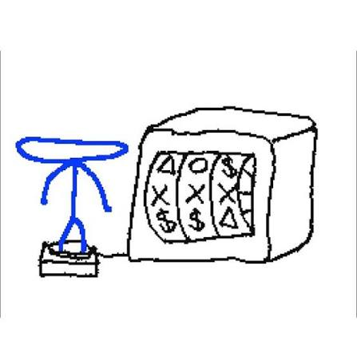

# 📇 Projeto 02: PassGuardian - Agenda de Contatos

### Arthur s.t

**Projeto 02: Agenda de contatos feita a partir da versão V4.1.0 do projeto de Agenda de Contatos, cuja é feita durante as aulas de POO**

**Essa projeto não necessariamente é o final, apenas um teste de tentar estruturar o projeto. Interfaces e elementos representam apenas experimentos**

NOTA: O projeto vai tentar seguir as aulas de POO, atualizando formatos e sua estrutura de forma a ficar coerente e mais adequada para funcionar melhor

---

## 🎯 Objetivo

Construir um sistema completo de CRUD (Create, Read, Update, Delete) para contatos, aplicando na prática a evolução dos conceitos de POO, separação de responsabilidades e persistência em arquivos.

---

## 🚀 Funcionalidades

- **Gerenciamento Completo (CRUD):** Cadastrar, listar, pesquisar, atualizar e remover contatos.
- **Persistência Automática:** Salva a lista em um arquivo de texto (`contatos.txt`) e recupera os dados de forma transparente ao iniciar o sistema.
- **Tratamento de Falhas:** Tratamento de exceções estruturado para garantir que erros de gravação não quebrem a execução do programa.
- **Sobre o Sistema:** Tela informativa com detalhes do software.

### 📝 Estrutura de um Contato
Cada registro armazena estritamente:
* `Nome`
* `Celular`
* `E-mail`

---

## 🛠️ Tecnologias e Conceitos

### Stack Técnica
* **Linguagem:** Java
* **Coleções:** Collections Framework (`List` e `ArrayList`)
* **Versionamento:** Git & GitHub

## 💾 Detalhes da Versão Atual (`V1.1.0`)

Adicionado mais controle de dados:
- Não pode inserir dados vazios
- Sistema de busca traz todos os contatos que tenham o texto que você informou

---

## ⏳ Histórico de Evolução

| Versão | Fase | Principais Implementações |
| :---: | :--- | :--- |
| **V1.0.0** | Anterior | DAO totalmente orientado a objetos (métodos de instância e construtores). |
| **V1.1.0** | Atual | Adicionado controle de dados e melhorar busca. |
---

## 🔧 Como Executar o Projeto

1. Certifique-se de ter o **Java JDK** (versão 8 ou superior) instalado em sua máquina.
2. Clone este repositório ou baixe os arquivos de código.
3. Abra a pasta raiz do projeto na sua IDE de preferência (Eclipse, IntelliJ, VS Code, NetBeans).
4. Navegue até o arquivo `02-AgendaContatos/src/br/edu/principal/Principal.java`.
5. Execute o método `main`.
6. Interaja com o sistema através do menu interativo no console/terminal.

---
#### let's go gambling!

⬆️"Oh dang it!"⬆️